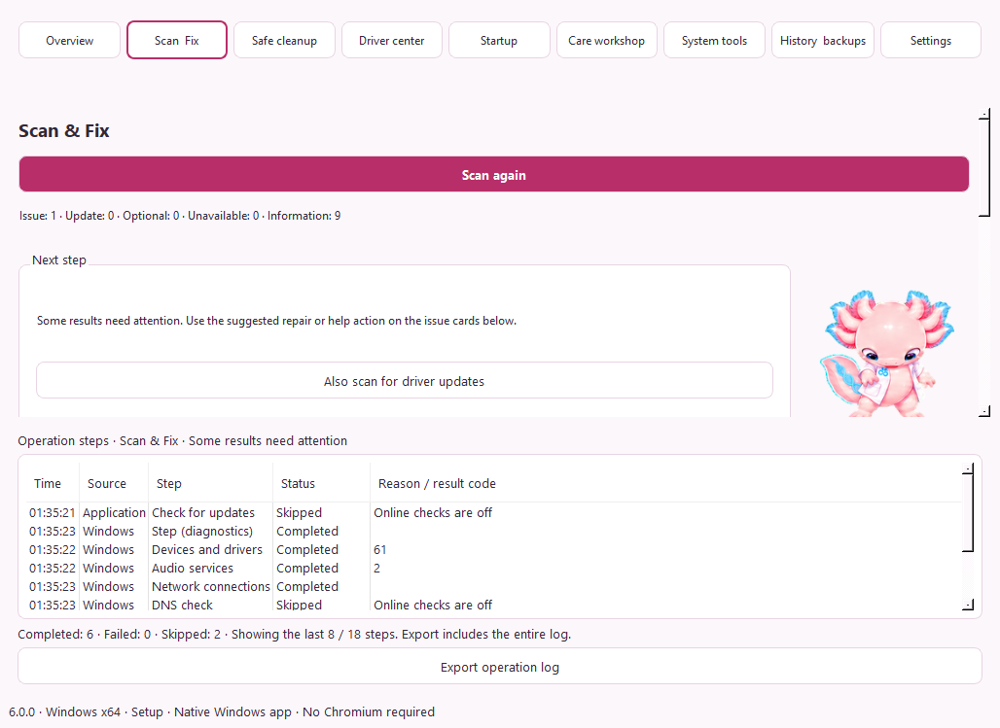

# WinOptimizer Aion

[Son kararlı sürüm / Latest release](https://github.com/kaansavukduran/WinOptimizer/releases/latest) · **Windows x64**

Pembe axolotl Aion ile Türkçe/English Windows bakım uygulaması. **6.x arayüzü Python + Qt Widgets kullanır. Electron, Chromium, Qt WebEngine veya kurulu bir tarayıcı gerekmez.** Python ve Node.js çalışma zamanları paketin içindedir; kullanıcı ayrıca kurmaz. Windows işlemleri mevcut, sınırlandırılmış Node.js/PowerShell katmanından yürütülür.

A bilingual native Windows care app. The 6.x GUI uses Python/Qt Widgets, with a bundled headless Node.js and Windows PowerShell backend. It does not use a browser engine. Earlier releases and their source remain available.

## İndir ve aç / Download and open

[Releases](https://github.com/kaansavukduran/WinOptimizer/releases) sayfasında aynı sürümün iki Windows x64 dosyası bulunur:

| Dosya | Kullanım |
| --- | --- |
| `WinOptimizer-Aion-<sürüm>-Windows-x64-Setup.exe` | Çift tıkla, kurulum konumunu seç ve Başlat menüsünden **WinOptimizer Aion** uygulamasını aç. |
| `WinOptimizer-Aion-<sürüm>-Windows-x64-Portable.exe` | Yazılabilir bir klasöre indir ve çift tıkla. Kurulum sihirbazı gerekmez. |

Windows 10 22H2 veya Windows 11 x64 ve Windows'un kendi PowerShell 5.1'i gerekir. Windows 10 servis/ESU desteğini uygulama uzatmaz. Kurucunun Authenticode sertifikası henüz yoktur. Uygulama içindeki Setup güncellemeleri gömülü Ed25519 anahtarı ve SHA-256 ile doğrulanır. Release'taki SHA256SUMS.txt iki paketi de listeler.

Download either **Setup.exe** for installation or **Portable.exe** for direct use. Double-click the file. No separate Python, Node.js, Chrome, Chromium, account or subscription is required. The installer is not Authenticode-signed; authenticated in-app installer updates use Ed25519 metadata and SHA-256.

## İlk kullanım / First use

1. **Tara ve Düzelt → Taramayı başlat.** Sürücü teklifleri için çevrimiçi kontrol varsayılan açıktır. Tarama sistem ayarlarını değiştirmez, indirme/kurulum başlatmaz. İnternetsiz kontrol için **Tarama seçenekleri → Çevrimiçi kontrolleri de yap** seçeneğini kapat.
2. **Sıradaki adım** bölümünü oku. Sürücü teklifleri varsa **Tümünü güncelle (sayı)** ile tek tek kutu işaretlemeden devam et. Sonuç filtreleri bu toplamı daraltmaz. İstersen Sürücü merkezinde yalnız seçtiğin teklifleri yükleyebilirsin.
3. Onay penceresindeki sürücü listesini incele. Onaydan sonra Windows yönetici izni ister; mevcut üçüncü taraf sürücüler otomatik yedeklenir, ardından seçilen teklifler yüklenir. Sonuçlar sürücü başına gösterilir. Başarısız öğeler başarı sayılmaz. Gerekirse Windows'u yeniden başlat.

**Güvenli temizlik** ayrı bir işlemdir: tara, adayları incele, **Güvenli depoya taşı**. **Geçmiş ve yedekler → Geri al** dosyaları geri getirir; var olan yeni dosyaların üzerine yazılmaz. **Kalıcı sil ve alan aç** geri alınamaz.

English: **Scan & Fix → Start scan → Next step → Update all (count) → review and confirm**. Online driver checks are enabled by default; disable them under **Scan options** for a local scan. Windows asks for administrator permission before driver backup/installation. Review per-driver results rather than assuming all succeeded. Safe cleanup is a separate preview → vault → restore/permanent-delete flow.

## Donanım / Hardware

**Donanım → Donanımı tara** bilgisayarın yerel özelliklerini okur: işlemci/çekirdekler, ekran kartı ve ayrılmış VRAM, RAM modülleri/türü, anakart, BIOS, disk/birimler, ekran, ağ, ses, pil ve Windows aygıtları. Arama ve kategori filtresiyle bul; ayrıntıları genişlet veya JSON raporunu dışa aktar. İnternet veya yönetici izni gerekmez. Her kategorinin gerçek okuma sonucu işlem günlüğünde görünür.

VRAM, DXGI'nin 64 bit değeridir; paylaşılan sistem belleği ayrıca gösterilir. Okunamayan bilgi tahmin edilmez. Sensör sıcaklığı, fan/PSU modeli gibi Windows'un standart olarak sunmadığı bilgiler her bilgisayarda bulunamaz. [Kaynaklar ve sınırlar](docs/HARDWARE.md).

**Hardware → Scan hardware** reads local specifications, supports search/category filtering and exports JSON. Missing providers and absent devices have different labels. Dedicated GPU memory uses DXGI 64-bit counts; shared RAM stays separate. This is a read-only inventory, not a hardware benchmark or health diagnosis.

[Gerçek Windows Donanım ekranı](docs/screenshots/WinOptimizer-6.1.0-Windows-Donanim.png) — test sanal makinesinin özelliklerini gösterir.

## İşlem gerçekten çalışıyor mu? / Observable operations

**İşlem adımları** bölümü Windows arka ucundan gelen gerçek aşamaları gösterir. Uygulama isteği ile Windows kaynaklı olaylar ayrılır. Her adımın son durumu, ölçülebilen adetleri, hata/sonuç kodu ve atlama nedeni görünür. Tamamlanan, başarısız olan ve atlanan adımlar ayrı sayılır. Toplam bilinmeyen işlerde uydurma yüzde gösterilmez; çalışan durum ve geçen süre gösterilir.

Örneğin çevrimiçi arama kapalıysa Windows Update **Atlandı: çevrimiçi kontrol kapalı** olarak kaydedilir. Aygıt/ses/ağ/ekran/bileşen sağlayıcı hataları görünür; erişilemeyen bilgi sağlıklı sayılmaz. Temizlikte yeni dosyalar, bağlantılar, bulunamayan/erişilemeyen klasörler ve tarama sınırı da nedenleriyle raporlanır. Bir dosya taşıma veya geri alma kısmen başarısız olursa sonuç bunu belirtir.

Ekran adımların son durumlarını özetler. **Günlüğü dışa aktar**, bütün zaman sıralı olayları JSON raporuna ekler. Son işlem günlüğü uygulama yeniden açıldığında korunur; beklenmedik kapanışta yarım kalan işlem tamamlandı sayılmaz. Bu, Windows'taki her donanım arızasını saptama veya her sorunu otomatik çözme garantisi değildir.

Operation steps show actual backend events, their source, latest state, counts, failures and skip reasons. The entire chronological log can be exported, and the last operation survives reopening. Unknown totals remain indeterminate. An accepted package or opened settings page is not proof that a device issue was repaired.

## Portable veri ve güncelleme / Portable data and updates

Portable EXE'nin yanında **Data/WinOptimizer Aion** klasörü oluşur. Ayarlar, geçmiş, günlük ve sürücü yedekleri burada tutulur. Taşırken EXE ile Data klasörünü birlikte taşı. Yazılamayan klasörde sessizce başka konuma geçmek yerine hata gösterilir. Self-extracting portable launcher çalışırken Windows geçici dizinini kullanır.

Portable güncelleme şimdilik elle yapılır: **Ayarlar → Güncellemeler → Güncellemeleri kontrol et → Portable dosyasını indir**. Uygulamayı kapat, yeni `-Portable.exe` dosyasını aynı Data klasörünün yanına koy ve yeni dosyayı aç. Data'yı silme. Portable mod Setup kurucusunu çalıştırmaz. Tarayıcıyla elle indirilen portable dosya uygulama tarafından otomatik kurulmaz veya doğrulanmaz; Release SHA-256 özeti ayrıca kontrol edilebilir.

Kurulu sürümün verisi `%LOCALAPPDATA%\WinOptimizer Aion` içindedir ve portable verisinden ayrıdır. Setup güncellemesi ve kaldırma kullanıcı kayıtlarını silmez. Eski 5.3.x ayar/geçmiş biçimi yeni yerel sürümde kullanılmaya devam eder. Kurulu güncelleme: **Ayarlar → Güncellemeler → Güncellemeleri kontrol et → Güncelle ve yeniden başlat**.

Keep the adjacent **Data** folder when moving or replacing the portable executable. Portable and installed records are separate. Portable updates currently use manual EXE replacement; installed updates retain the authenticated installer workflow. Keep the `-Portable.exe` filename suffix to select portable mode.

## Gerçek Windows görüntüleri / Installed Windows screenshots

Kurulu 6.0.0 uygulaması, Windows sanal makinesi. Sayılar o makineye aittir. [5.3.0’dan yerel Qt sürümüne gerçek geçiş doğrulaması](https://github.com/kaansavukduran/WinOptimizer/actions/runs/42737857096).



[Ayarlar korunarak güncellenmiş yerel uygulama](docs/screenshots/WinOptimizer-6.0.0-Windows-native-upgraded.png).

## Özellikler ve sınırlar / Features and limits

- Yerel Windows sağlık/aygıt/ses/ağ/ekran/oyun bileşeni kontrolleri; isteğe bağlı çevrimiçi Windows Update/DNS araması, onaylı dar kapsamlı düzeltme ve son kontrol.
- Sürücü envanteri, Windows Update'in bu cihaza sunduğu seçmeli veya toplu sürücü güncellemeleri, otomatik üçüncü taraf sürücü yedeği, tek kullanımlık onay planları ve imzalı yerel INF/CAT klasörleri. 20'den büyük WUA seçimleri komut satırı sınırına takılmayan hash sabitlenmiş planla aktarılır. Firmware yüklenmez. Yedek tam sistem imajı veya garantili sürüm düşürme değildir.
- Microsoft'un resmî Visual C++ v14 x86/x64 ve DirectX June 2010 kurucularını indirip yayıncı imzası/hash doğrulama; ayrı lisans/onay ve kurulum göstergesini yeniden okuma. Evrensel oyun DLL onarımı değildir.
- Yaş filtreli kullanıcı Temp/Chrome/Edge Default önbellek temizliği; bağlantı koruması, önizleme, geri alınabilir depo ve ayrı kalıcı silme.
- HKCU Run başlangıç yönetimi/geri alma, DNS bilgisi ve önbelleği, mevcut güç planları ve çakışma korumalı geri dönüş; geri yükleme noktaları, bağlı olmayan seçili aygıt kayıtları ve odak oturumu.
- Türkçe/English, açık/koyu/sistem/yüksek kontrast, bağımsız arayüz ölçeği %80–%200, yazı boyutu, font, paketli Türkçe karakterli OpenDyslexic, satır/harf aralığı ve hareket/ses tercihleri. Ayarlar en sağdaki son gezinme öğesidir; alt kategoriler Ayarlar içindedir.
- Aion'un çizilmiş 16 bakış yönü, baş/gövde/kuyruk/ayak tepkileri, klavyeyle sevme ve işlem kareleri. Sistem azaltılmış hareketi, duraklatma ve görünür alan desteği. Gerçek kontrollerden ilerleyen isteğe bağlı bakım yolculuğu; sevilme puan üretmez.

**Eski terminal sürümünün bütün özellikleri taşınmış değildir.** Genel Windows OS güncellemesi yükleme, winget uygulama güncellemesi, tüm başlangıç görevleri, sıcaklık/ayrıntılı SMART/SFC/olay günlüğü analizi eksiktir. Geniş registry/hizmet/ağ değişiklikleri ve DISM ResetBase uygulanmaz. [Ayrıntılı terminal karşılaştırması](docs/LEGACY-COVERAGE.md), [Driver Booster for Steam kapsamı](docs/DRIVER-COVERAGE.md) ve [sürücü kaynakları/katalog tasarımı](docs/DRIVER-CATALOG.md).

Otomatik sürücü kaynağı bugün Windows Update'tir; bağımsız global/OEM veya özel IObit kataloğu yoktur. Resmî üretici ve Microsoft Catalog bağlantıları elle yönlendirmedir. Yerel akışlar internetsiz çalışır; çevrimiçi teklifler, uygulama güncellemeleri ve indirmeler bağlantı ister. Telemetri ve kendiliğinden arka plan kurulumu çalışmaz.

## Geliştirme / Development

Normal kaynak girişi `native/app.py`; Node köprüsü `desktop/native-bridge.cjs`, sistem eylemleri `backend/Windows.ps1`. Qt Widgets/QPainter yerel arayüzdür; HTML/DOM/WebEngine kullanılmaz. Eski React/Electron kodu kaynak ve davranış referansı olarak korunur; 6.x paketine yüklenmez.

```sh
# Python 3.12, Node.js 24
python -m venv .venv
# Windows:
.venv\Scripts\python -m pip install -r native/requirements.txt pytest==8.3.5
npm ci
.venv\Scripts\python native/app.py
npm test
.venv\Scripts\python -m pytest -q tests/native
# Windows x64 + NSIS:
.venv\Scripts\python scripts/build-native.py
```

Windows Actions gerçek PowerShell protokolünü, temiz Setup kurulumunu, kurulu Qt UI üzerinden sağlık/tarama/temizlik/geri alma ve portable yeniden açılış/veri ayrımını doğrular. Paket arşivi Electron/Chromium/Qt WebEngine girdileri için ayrıca denetlenir. Güncelleme akışı iki yayımlanmış paketi kullanır. [Doğrulama](docs/VALIDATION.md) ve [Forge kaydı](FORGE.md).

## Kaynak ve lisans / Origin and license

[OguzhanDUYAR/WinOptimizer](https://github.com/OguzhanDUYAR/WinOptimizer) fork'u. Eski betikler ve tarihçe `legacy/` içinde korunur; yeni uygulama bu betikleri çalıştırmaz. Mevcut **GPLv3 LICENSE** korunur; upstream README'nin farklı MIT ifadesi yeniden lisanslama olarak kullanılmaz. PySide6/Qt LGPL ve diğer paketlerin bildirimleri [THIRD_PARTY_NOTICES.md](THIRD_PARTY_NOTICES.md) ve `native/licenses` içindedir. Eski yayımlanmış sürümler değiştirilmez.
