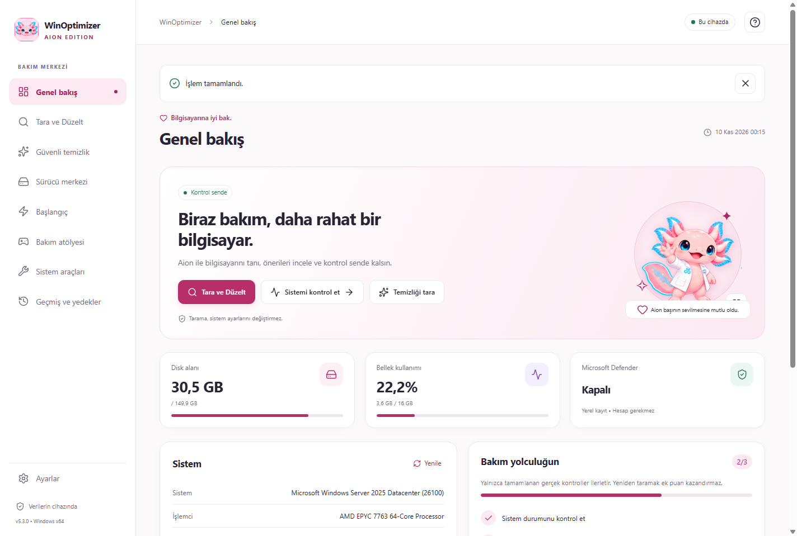

# WinOptimizer Aion

[Son kararlı sürüm / Latest release](https://github.com/kaansavukduran/WinOptimizer/releases/latest) · Windows x64

Windows için pembe axolotl Aion eşliğinde, Türkçe ve İngilizce bakım uygulaması.
Windows only. A bilingual, local-first care center with Kaan’s animated axolotl Aion.

## Kurulum / Installation

1. [Releases](https://github.com/kaansavukduran/WinOptimizer/releases) sayfasından `WinOptimizer-Aion-<sürüm>-Windows-x64-Setup.exe` dosyasını indirin.
2. Dosyaya çift tıklayın, kurulum konumunu seçin, kurulumu tamamlayın. Başlat menüsünden **WinOptimizer Aion** uygulamasını açın.
3. **Sistemi kontrol et** ile gerçek donanım ve koruma durumunu görün. **Temizliği tara** ile adayları listeleyin. Seçilenleri **Güvenli depoya taşı** düğmesiyle taşıyın.
4. **Geçmiş ve yedekler** üzerinden geri alın. Alan kazanmak için ayrı **Kalıcı sil ve alan aç** işlemini seçin; bu işlem geri alınamaz.
5. **Ayarlar** yan menünün en altındadır. **Genel ve Dil**, **Görünüm**, **Erişilebilirlik**, **Aion ve Bildirimler**, **Veri ve Yedekler**, **Güncellemeler**, **Hakkında** grupları vardır.

Download the Windows x64 Setup.exe from Releases, double-click it, finish setup, and open **WinOptimizer Aion** from Start. Use **Check system**, then **Scan for cleanup**, review candidates, and **Move to safe vault**. **History & backups** lets you restore files or delete them permanently. Settings is the last navigation item. Choose **English** in **Genel ve Dil → Dil**.

Requires Windows 10 22H2 or Windows 11 x64 and built-in Windows PowerShell 5.1. Windows 10 support depends on the installed servicing/ESU channel; this app does not extend Microsoft support. No PowerShell Gallery module, account, API key, or subscription is needed. Installer Authenticode status is documented in release notes. Updates are separately authenticated by an embedded Ed25519 public key and SHA-256.

## Özellikler / Features

- **5.3.0 Etkileşimli Aion:** 16 çizilmiş yön ile fareye bakar; baş, gövde, kuyruk ve ayak dokunuşuna tepki verir. Enter/Boşluk ile de sevilebilir. Ayarlar → Aion ve Bildirimler içinde fare takibi, sevilme ve %75–%150 Aion boyutu bağımsızdır; azaltılmış hareket ve duraklatma desteklenir.
- **Tara ve Düzelt / Scan & Fix:** aygıt hata kodları, ses servisleri, ağ, ekran ve oyun bileşeni göstergeleri; isteğe bağlı Windows Update/DNS kontrolleri. Tarama sonucundan güncellemeleri seç → onay → otomatik sürücü yedeği → yükleme → sürücü başına sonuç. Onaylı ses servisi başlatma, aygıt yeniden algılama ve DNS temizliği aynı sorunu yeniden denetler. [Kapsam ve sınırlar](docs/SCAN-FIX.md).
- **Bakım atölyesi:** imzalı yerel sürücü klasörlerini ve yedeklerini inceleyip seçmeli uygulama; çevrimdışı donanım kimliklerini dışa aktarma; atlanan güncellemeler; seçili bağlı olmayan aygıt kayıtları; geri yükleme noktaları; geri alınabilir odak/güç planı. Microsoft'un resmî Visual C++ v14 x86/x64 ve DirectX June 2010 kurucuları indirilir, yayıncı imzası doğrulanır, ayrıca onayla kurulur ve son durum okunur. [Driver Booster for Steam karşılaştırması](docs/DRIVER-COVERAGE.md).

- Salt okunur sistem kontrolü: işletim sistemi, CPU, RAM, disk alanı, Windows’un sağladığı disk sağlığı, Defender, güvenlik duvarı, BitLocker. Erişilemeyen bilgi açıkça belirtilir.
- Yedi gündür değişmeyen kullanıcı Temp dosyaları ve Chrome/Edge **Default/Cache/Cache_Data** önbellekleri. En fazla 10.000 aday, değişiklik kontrolü, bağlantı/junction koruması, dosya önizlemesi ve geri alınabilir depo.
- Sürücü envanteri, aygıt hata kodları, imza bilgisi, Windows Update’in cihaza sunduğu seçmeli sürücü güncellemeleri. Yükleme ve üçüncü taraf sürücü deposu yedeği yönetici izni ister. Üretici uygulamaları, inbox sürücüler, BIOS/firmware yedeğe dahil değildir.
- Kullanıcının HKCU Run başlangıç kayıtlarını kaldırma ve geçmişten geri yükleme. Diğer kullanıcıların kayıtları değiştirilmez.
- Ağ/DNS bilgisi, yalnızca DNS önbelleğini temizleme, var olan güç planlarını seçme ve önceki plana geri dönme.
- TR/EN, açık/koyu/sistem/yüksek kontrast, bağımsız %80–%200 arayüz ölçeği (%5 adım ve elle yüzde), %80–%160 yazı boyutu, sistem/Verdana/OpenDyslexic, satır/harf aralığı, vurgu rengi, yoğunluk, ayrı hareket ve ses tercihleri.
- Gerçek karelerden Aion işlem animasyonları ve RealLife Aion paftasından fare/sevilme tepkileri. Gerçek tamamlanan üç kontrolü izleyen isteğe bağlı bakım yolculuğu; sevilme, kozmetik değişiklikler ve tekrarlar puan üretmez.
- Ayar/geçmiş JSON dışa aktarma, görünüm içe aktarma, önceki ayarların otomatik kopyası ve rapor dışa aktarma. İçe aktarılan geçmiş sistem komutu olarak oynatılmaz.
- Düğmeyle başlayan güncelleme kontrolü; kanal/mimari/sürüm, Ed25519 imzası ve paket SHA-256 doğrulanır. Bozuk/kesik indirme kurulmaz.

English: read-only health checks; scoped, age-filtered cleanup with recoverable quarantine; driver inventory, third-party backup and selected Windows Update drivers; reversible current-user startup management; DNS diagnostics/cache clearing and existing power plan selection; persistent bilingual appearance/accessibility settings; frame-by-frame Aion; optional real-check milestones; local exports; authenticated user-initiated updates.

## Veri ve geri alma / Data and recovery

Kayıtlar `%LOCALAPPDATA%\WinOptimizer Aion` içindedir. `settings.json` görünümü, `activity.json` geçmişi, `quarantine` geri alınabilir dosyaları, `DriverBackups` sürücü paketlerini içerir. Kaldırma ve güncelleme bunları silmez. Taşıma aynı diskte alan açmaz; kalıcı silme ayrıca yapılır. Geri alma yeni dosyaların üzerine yazmaz; çakışan dosyalar yedekte kalır.

Sürücü yedeği için **Aygıt Yöneticisi → ilgili aygıt → Sürücüyü güncelleştir → Bilgisayarımdaki sürücülere göz at** yolunda yedek klasörünü seçebilirsiniz. Windows uygun paketi seçer; eski sürüme geçiş her aygıtta garanti edilmez. Driver backup is not a complete system image or an automatic recovery guarantee.

Offline: local scans, history, settings and cleanup work. Windows Update, application update checks and downloads need internet. No automatic background updating or telemetry runs.

Automatic driver offers currently come from Windows Update for the current PC; the app does not operate an independent global/OEM driver database. Official vendor/catalog buttons are manual handoffs. See [catalog architecture and sources](docs/DRIVER-CATALOG.md). Firmware is excluded from driver installation. A higher version or older installed date alone does not prove compatibility.

## Gerçek Windows ekranları / Installed Windows screenshots

[5.2.0 → 5.3.0 gerçek güncelleme doğrulaması](https://github.com/kaansavukduran/WinOptimizer/actions/runs/42726691878). Görüntüler Windows sanal makinesinde kurulu uygulamadan alınmıştır; cihaz değerleri o makineye aittir.



[Fare takibi](docs/screenshots/WinOptimizer-5.3.0-Windows-pointer-tr.png) · [Tara ve Düzelt](docs/screenshots/WinOptimizer-5.3.0-Windows-scan-tr.png) · [Bakım atölyesi](docs/screenshots/WinOptimizer-5.3.0-Windows-workshop-tr.png) · [Koyu tema](docs/screenshots/WinOptimizer-5.3.0-Windows-dark-tr.png)

## Development

Development requires Node.js 24. End users only need Setup.exe; Node.js is not required to run the installed app.

```sh
npm ci
npm run check
npm run dev
npm run build
npm start
# Windows:
npm run dist:win
```

The browser development entry labels itself as a preview and never fabricates Windows data. Windows operations use the isolated preload/main bridge and a fixed PowerShell action allowlist, not arbitrary shell strings.

```sh
npx playwright install chromium
npm run test:e2e
```

`tests/windows-backend.ps1` runs the real Windows/PowerShell 5.1 path. CI installs a real NSIS package and exercises the installed app. A separate workflow tests in-app updating between two published packages and preservation of settings/history. See [FORGE.md](FORGE.md) and [docs/VALIDATION.md](docs/VALIDATION.md) for verified results and remaining work.

## Origin and license

Fork of [OguzhanDUYAR/WinOptimizer](https://github.com/OguzhanDUYAR/WinOptimizer). Upstream history and scripts are preserved in `legacy/`; they are not used or packaged by the desktop app. Broad deletion, registry cleaning, blanket service/network tweaks, Prefetch deletion and DISM `/ResetBase` are excluded. Root launchers open only the desktop app.

The existing **GPLv3 LICENSE** is retained for the new code. Upstream README/script headers said MIT despite the GPLv3 LICENSE; this fork does not claim to relicense upstream work as MIT. See [THIRD_PARTY_NOTICES.md](THIRD_PARTY_NOTICES.md).
